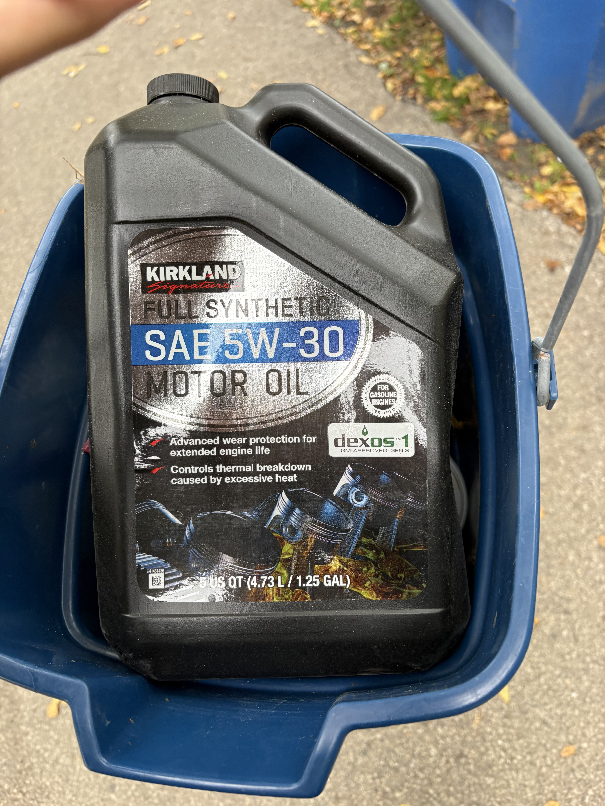
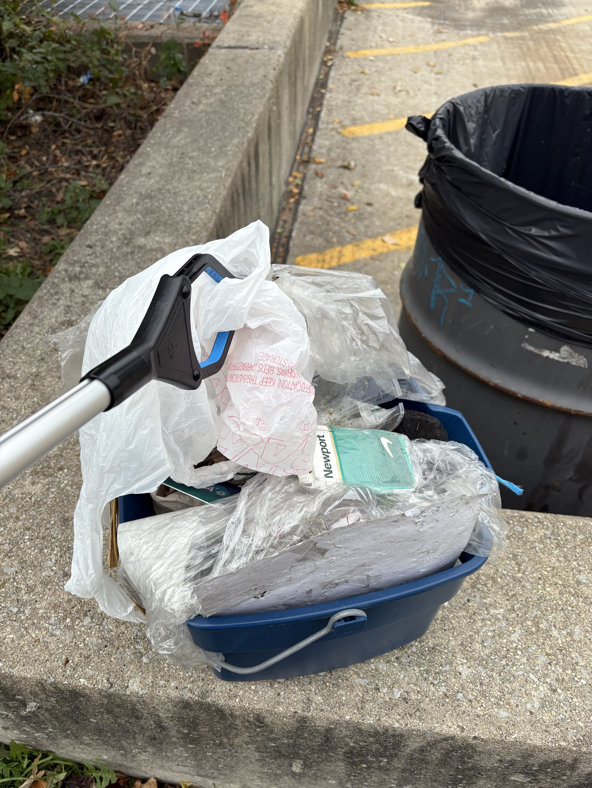
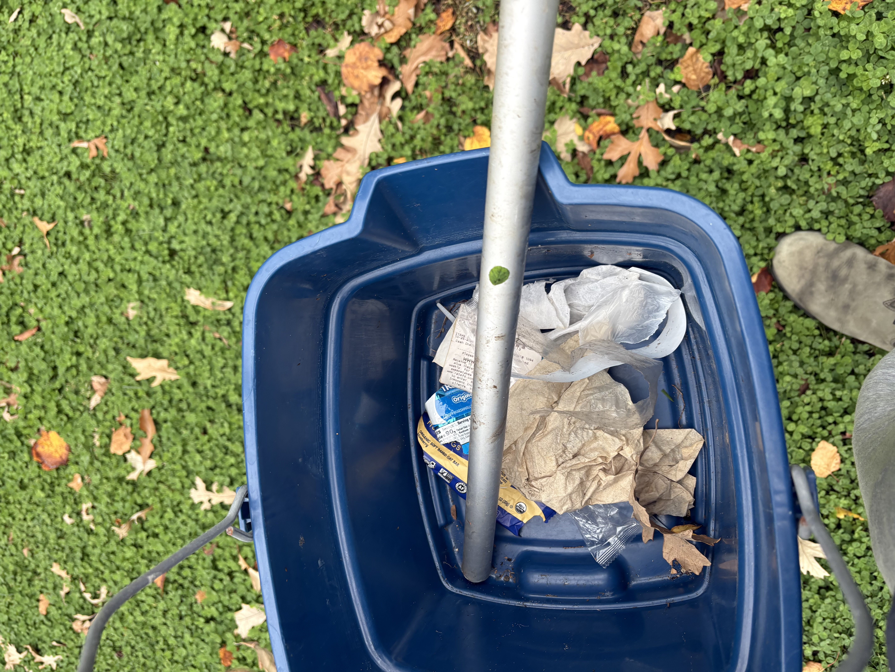
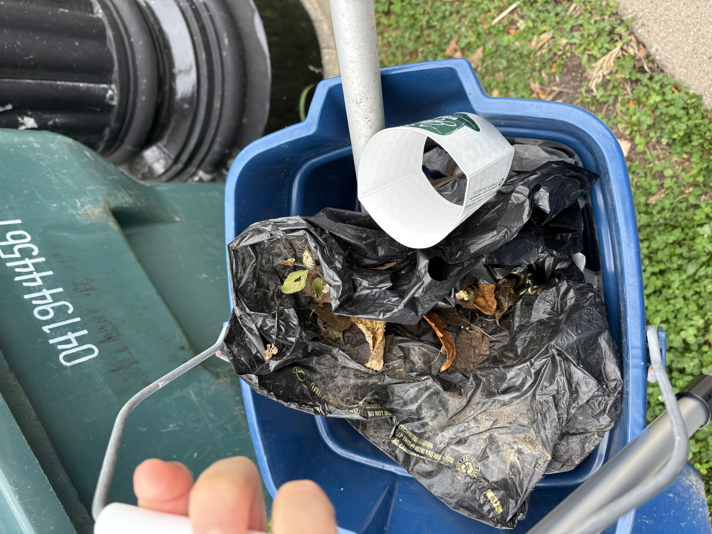
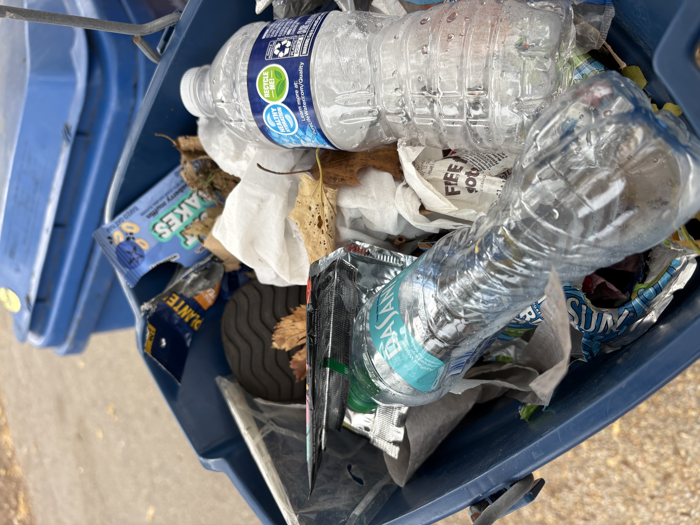

DEAR PAID SUBSCRIBERS. 

IT IS A PRIVILEGE TO HAVE YOU OUT HERE, SUPPORTING ME IN... WHATEVER THIS IS. 

I WANT YOU TO KNOW HOW MUCH IT MEANS TO ME THAT YOU HAVE SUBSCRIBED TO THIS NEWSLETTER. 

SO I SPENT AN HOUR FOR EACH OF YOU PICKING UP TRASH. 

HERE IS SOME OF THE TRASH: 

THIS FELT LIKE A BIG WIN: 







THE OTHER NICE THING IS THAT THERE WAS A BIG PLASTIC BAG OUT HERE: 


so much big bag





THEN THERE WAS A WHOLE BUNCH OF WHAT I WOULD CALL "NORMAL TRASH":






