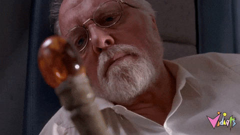
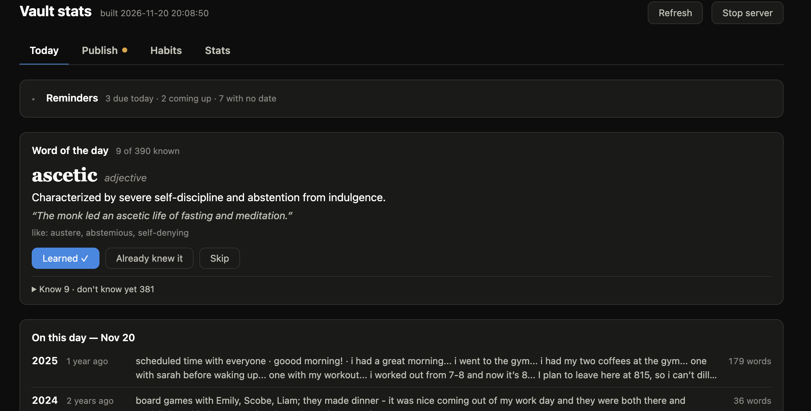
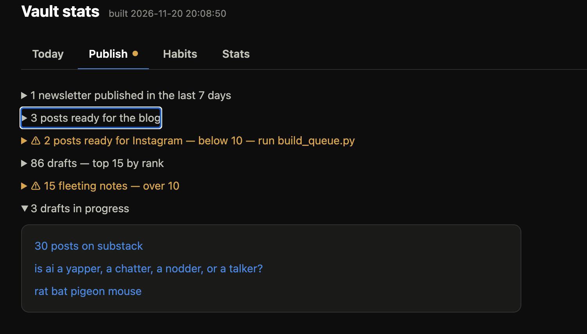
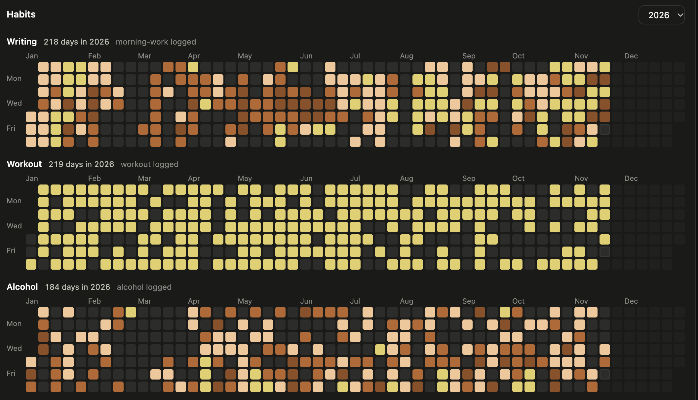

I'm a sucker for a good check-in. 

I do a check-in every day for all I care. 

I'll do a check-in mid check-in: *How're we feeling about this check-in?* *Is this going okay? We liking this?* That's the best kind of check-in if you ask me. 

And we're coming up on check-in season, baby! Tis the season of yearly reviews, of resolution-making, of sitting in front of a lil yuletide fire thinking about life 🔥🌀🔮 

The fact that the winter solstice is there in the middle of it is 👌👌👌 chef's kiss. 

I just got back from the dentist, which is a specific type of check-in -- let's get one for the teeth! -- but also, at least for the past 2 years or so, a sort of spiritual check-in

> [reveal] say what
> 

2 years ago, on the day that I was scheduled to see my dentist, I experienced the most zen-flow perfect energy day of all time. 

That usually doesn't happen to me. Usually, I'll drop an f-bomb pre-730 AM because I dropped my breakfast brownie in the sink, and now it's got yesterday's wet-ass quinoa on it. 

So I remembered it. It was in January, post Christmas, and I had my hometown priest's Christmas homily in my head. 

Priests gotta go hard for Christmas. There's a joke written about this somewhere, and it ain't mine. Everybody's there! You gotta ball hard. Make the people want to upgrade their membership to once a week or whatever!

I was pretty skeptical that our priest-man was going to deliver. I don't want to punch down here, but sometimes it feels like they're freestyling up there, and it's not working. They get down a path, decide "no this is a dead-end," and then just ... say whatever the heck Jesus said in the Gospel in different words. 

2 years ago? Our priest guy freaking balled out. Crushed it. I remember thinking, mid-priest speech time, *Oh man. This is money.* He talked about reflection, about asking yourself "What are you like to be around? How do people experience you? What kind of energy are you putting out into the world?" 

These were the questions rattling around in my head as I walked to get my teeth cleaned. 

And for whatever reason (because I desperately want to be good? Because I need to be *nice* to be around??) I went to the dentist and I was so relaxed and joyful and open, and idk it felt like me and my hygienist became... friends. Buds! homies! We vibed. It was great! 

And that energy has been Jurassic-park, mosquito-in-a-mans-walking-stick crystallized in time since then. Now, every 6 months when I go to the dentist, I sort of become that person again, and I'm reminded that it's possible, that life is good, and that teeth CAN be cleaned, and all that.  



### Project updates 

Markdown File Pile (Obsidian, Zettlekasten, and a Dashboard??)

I feel like I'm finally getting to a spot where my pile of markdown files (plain text files) are useful.  I put a dashboard in front of those files and started to build in some functionality. 

Whenever I open my journal, it starts this dashboard. The first page has all my reminders in it (each reminder is, yes, a simple text file), there's a lil word of the day, and also any journal from this day a year ago, 2yr ago etc. 



Next! We've got my lil tracker for making sure I've got all my writing todos in line. Each newsletter, blog post, etc also??? is just a text file. 

I use a template, which makes it easy to create "posts." Posts all have the same attributes at the top of the document (contained by these three little dashes '---') 

```

Category: Post 
status: Published
target: Blog, Newsletter, Instagram
published_date: 2026-11-11

...etc


```
There's a separate template for Recipes, Daily Journals, Reminders, Books, Movies -- truly the options are limitless. 

All of my posts for each platform (blog, instagram, newsletter) use a text file. Then there's something else (a python script) that handles getting the text file to each platform. All I have to do is write the thing and hit send. 

This was really important to me because I wanted to spend most of my time doing word stuff and not having to spend much time on any of the platforms. Now all I have to worry about is the writing. 


Lassttt but not least, we have the habit trackerrr. Woo! This is the one that I was really excited about. Every daily note or daily journal has the same attributes at the front of the document: 
```

tags: daily
writing-time: 50
workout: went for a two mile run
alcohol: 2

etc.. 

```

Anytime I journal in the morning, I also fill out the details from the previous day. From there, it was easy enough to create a heat map for all the attributes across the daily journals. 



At first when I was setting out on this quest, I felt like a total crazy person. Why was I so obsessed with text files! Finding Obsidian validated the whole idea of it, and also implemented a bunch of the things that I want to do.

But now - with Claude making it so so so easy to make lil local websites, python scripts to manipulate text files... I've been able to add on a lot of my own customizations. 

This whole dashboard has definitely helped me stay on track, and it's made everything just a bit more satisfying!
### Random
- Am I a tea guy?? My sister and I famously *hate* tea. That's probably not true. But we do love to hate on tea. Wet leaves??? In place of coffee!!!?? You gotta be kidding me. Anyway, I've been freaking [loving this tea.](https://www.thrivemushroom.com/product/reishi-lion-s-mane-mushroom-tea/ZB7BWCBSEAUX6OBFZRVJT3VL?cp=true&sa=true&sbp=false&q=false) I've been? happier?? recently?? Is it the tea???  
- [Jungle: Tiny Desk Concert](https://www.youtube.com/watch?v=73wCQRQb7v0) my lord my lord so good
- full moon is on the 23rd and 24th of December or something like that! Kind of festive! And helpful! Once I see that waxing gibbous I know I need to get my Christmas shopping started.
